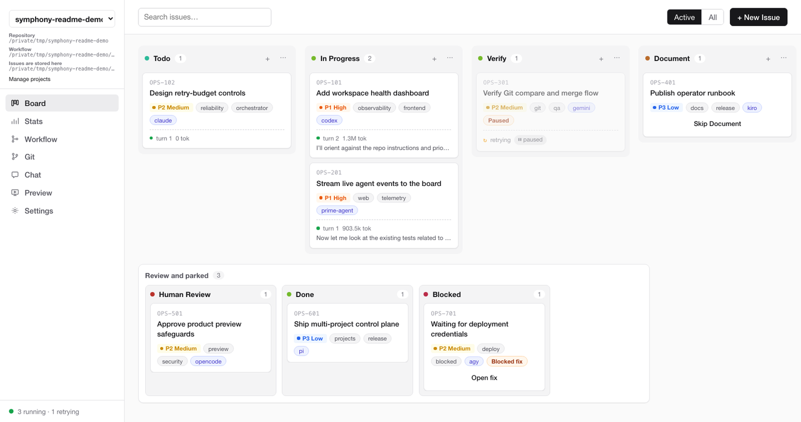

# oh-my-symphony

**[English](README.md) | 한국어**

[](LICENSE)
[](https://www.python.org/)
[](https://github.com/cskwork/oh-my-symphony/actions/workflows/tests.yml)

Symphony는 칸반 보드의 티켓을 AI 코딩 에이전트가 처리할 작업 큐로 바꿉니다.
티켓마다 별도의 `git worktree`에서 원하는 에이전트(Codex, Claude Code, Gemini,
AGY/Antigravity, Kiro, OpenCode, Pi, Prime Agent)가 실행되며, 진행 상황은
터미널 TUI나 9999 포트의 로컬 웹 보드에서 확인합니다. 티켓은 기본적으로
저장소 안의 Markdown 파일이며 Linear와 Jira도 지원합니다.



[OpenAI의 Symphony 레퍼런스 구현](https://github.com/openai/symphony)을 포크했습니다.
전체 설명은 **[docs/reference.md](docs/reference.md)**(영문)에 있습니다.

## 설치

Python 3.12 이상과 Git이 필요합니다. 아직 PyPI에 배포되지 않았으므로 이
체크아웃에서 설치합니다.

```bash
git clone https://github.com/cskwork/oh-my-symphony.git
cd oh-my-symphony
python3 -m venv .venv && source .venv/bin/activate
python -m pip install -e .
```

그다음 에이전트 CLI를 하나 이상 `$PATH`에 둡니다.

| `agent.kind` | CLI | 설치 / 로그인 |
|--------------|-----|---------------|
| `codex` | `codex` | `app-server` 하위 명령 필요 |
| `claude` | `claude` | Claude Code |
| `gemini` | `gemini` | Gemini CLI |
| `agy` | `agy` | Google Antigravity |
| `kiro` | `kiro-cli` | `kiro-cli login` 또는 `KIRO_API_KEY` |
| `opencode` | `opencode` | `npm install -g opencode-ai`, `opencode auth login` |
| `pi` | `pi` | `npm i -g @earendil-works/pi-coding-agent` 후 `/login` |
| `prime-agent` | `prime-agent` | Prime Agent 설치 스크립트 실행 후 `/login` 또는 provider API 키 |

정확한 설치 명령은 [레퍼런스](docs/reference.md#install-and-agent-clis)를 참고하세요.

## 5분 빠른 시작

**`oh-my-symphony` 체크아웃 안에서 티켓을 실행하지 마세요.** 에이전트가
오케스트레이터 자체를 수정하지 못하도록, doctor와 시작 과정은 Symphony 자체
저장소의 `WORKFLOW.md`를 거부합니다. 별도 프로젝트를 만들거나 등록하세요.

**1. 프로젝트를 만들거나 등록합니다.** `WORKFLOW.md`, `kanban/` 보드, 단계별
프롬프트, skill, `AGENTS.md`가 생성됩니다.

```bash
symphony project create "My App" --path ../my-app
# 또는 기존 디렉터리 등록 (Git과 빠진 파일만 안전하게 추가)
symphony project add /path/to/existing-project --name "My App"
cd ../my-app
```

직접 작성한 `WORKFLOW.md`만 있는 디렉터리라면 `symphony board init ./kanban`을 실행합니다.

**2. 에이전트를 고릅니다.** `WORKFLOW.md`의 `agent.kind`를 설정합니다
(예: `kind: claude`).

**3. 설정을 점검합니다.**

```bash
symphony doctor ./WORKFLOW.md      # 모든 줄이 PASS여야 합니다
```

종료 코드 `0`은 모든 검사 통과, `1`은 FAIL 있음, `2`는 `WORKFLOW.md`를
불러오지 못했다는 뜻입니다.

**4. 티켓을 추가합니다.**

```bash
symphony board new TASK-1 "Fix flaky pagination test" \
  --priority 2 --description "tests/test_pagination.py is flaky on CI."
```

**5. 실행합니다.** 터미널 TUI나 웹 보드를 사용합니다.

```bash
symphony tui ./WORKFLOW.md                        # 대화형 터미널 필요
symphony service start ./WORKFLOW.md --port 9999  # 백그라운드 서비스
# 브라우저에서 http://127.0.0.1:9999/ 열기
```

폴링 한 번(기본 30초) 안에 카드에 초록색 ●와 턴 수, 토큰 수가 표시됩니다.
작업이 끝나면 에이전트가 `kanban/TASK-1.md`에 `state: Done`을 쓰고
`## Resolution` 섹션을 덧붙이며, 이 파일 수정으로 카드가 이동합니다. 포트가
사용 중이면 `symphony tui`가 어떤 프로세스가 점유 중인지 알려 줍니다.

> **기본 hook은 티켓 작업 공간을 `symphony/<ID>` 브랜치의 `git worktree`로
> 붙입니다.** `agent.auto_merge_on_done`이 켜져 있으면 Done 시점에
> 오케스트레이터가 한 번 병합하므로, 같은 브랜치를 손으로 또 병합하지 마세요.

**아직 에이전트 CLI가 없다면** 내장 mock 백엔드로 LLM 호출 없이 카드 이동을
확인할 수 있습니다. [Mock demo](docs/reference.md#mock-demo-no-agent-cli-required)를 참고하세요.

## 명령어

| 명령 | 설명 |
|------|------|
| `symphony project create\|add\|list\|start\|stop\|status\|remove` | 독립 프로젝트 서비스 등록·실행 |
| `symphony hub` | 다중 프로젝트 허브 (기본 `127.0.0.1:8787`) |
| `symphony doctor [WORKFLOW]` | `WORKFLOW.md` 사전 점검 |
| `symphony board init\|ls\|new\|mv\|update\|show\|graph` | 검증을 거치는 파일 보드 티켓 도구 |
| `symphony tui [WORKFLOW]` | 오케스트레이터 + 터미널 칸반 TUI |
| `symphony [WORKFLOW]` | 헤드리스 실행 (웹 보드와 `WORKFLOW-PROGRESS.md` 포함) |
| `symphony service start\|stop\|restart\|status\|logs` | 관리형 백그라운드 오케스트레이터 |
| `symphony runs [WORKFLOW]` | 최근 실행 기록 |
| `symphony factory init\|sync\|start` | 자율 개발 팩토리 |
| `symphony pm demo` | 일회용 PM Workspace 데모 |
| `symphony release check` | 앱 릴리스 증거 검증 |

자주 쓰는 플래그: `--port`, `--host`, `--tui`, `--no-progress-md`,
`--no-keep-awake`, `--log-level`. 로그는 stderr로만 출력되므로
`2>> log/symphony.log`처럼 리디렉션해 보관합니다.

## 기능

**에이전트 백엔드.** 전역 기본값은 `agent.kind`로 정합니다. 티켓 frontmatter의
`agent_kind: codex`(또는 `board new --agent-kind`)로 티켓별 백엔드를 고정하고,
`agent.stage_kinds`로 레인별로 다른 백엔드를 쓰며, `agent.fallback_kinds`로
대체 백엔드를 지정할 수 있습니다.
[Agent backends](docs/reference.md#agent-backends)를 참고하세요.

**트래커.** 기본은 파일 보드(`tracker.kind: file`)입니다. Linear는
[`WORKFLOW.example.md`](WORKFLOW.example.md), Jira는
[`examples/WORKFLOW.jira.example.md`](examples/WORKFLOW.jira.example.md)를
참고하세요. 브라우저 편집은 파일 보드에서만 되고 Linear/Jira 보드는 읽기 전용
상태로 표시됩니다. [Trackers](docs/reference.md#trackers-file-linear-jira)를 참고하세요.

**웹 보드와 TUI.** `http://127.0.0.1:9999/`에서 프로젝트 전환, 보드 CRUD와
드래그 앤 드롭, 워크플로·프롬프트 편집, Git 검토와 병합, 운영자 채팅, 제품
미리보기, 실행 기록, 통계, 설정을 사용할 수 있습니다. TUI에서는 티켓
생성·편집, 일시정지·재개, Document 건너뛰기, 필터, 통계를 쓸 수 있습니다(`?`로
키 목록 확인). 프록시나 터널로 보드를 외부에 노출하기 전에
[Reverse proxy, tunnels, and API token](docs/reference.md#reverse-proxy-tunnels-and-api-token)을
반드시 읽으세요.

**자율 개발 팩토리.** `Ready -> Build -> Verify -> Done` 보드로 Wayfinder ->
Symphony -> Supergoal 흐름을 실행합니다.

```bash
git init my-product && cd my-product
symphony factory init . --agent opencode
git add . && git commit -m "Initialize Symphony factory"
# wayfinder/tickets/ 아래에 티켓을 만든 뒤:
symphony factory start ./wayfinder
```

Superdesign 브라우저 검증 gate에는 Node.js 18+, `@playwright/cli`
(`npm install -g @playwright/cli@latest`), `playwright-cli install --skills`가 필요합니다.
[Autonomous development factory](docs/reference.md#autonomous-development-factory)와
[팩토리 가이드](skills/symphony-skill/reference/factory.md)를 참고하세요.

**PM Workspace.** 변경 사항을 기획(아이디어, 요구사항, 설계, 계획)하고 보드
티켓으로 넘깁니다. `symphony pm demo`(한국어는 `--lang ko`)로 체험할 수 있으며
Git과 Node.js 20.19.0 이상이 필요합니다.
[docs/pm-workspace.md](docs/pm-workspace.md)를 참고하세요.

**레인 프리셋.** `default`(Todo, In Progress, Verify, Document)와
`deep`(Intake부터 Document까지 8개 레인) 중 하나를 Settings에서 고릅니다.
[Lane presets](docs/reference.md#lane-presets-and-stage-contracts)와
[docs/PIPELINE.md](docs/PIPELINE.md)를 참고하세요.

**그 밖의 기능:** 승인 한 번으로 끝나는 채팅 인테이크, 선택형 앱 릴리스 계약,
실험적 지속 개선, Slack 알림, 영어·한국어 UI(`tui.language` / `SYMPHONY_LANG`),
macOS 화면 잠금 방지(keep-awake). Windows에서는 Git Bash가 필요합니다.
[Platforms](docs/reference.md#platforms)를 참고하세요.

## 문서

- [docs/reference.md](docs/reference.md): 설정, 명령, API, 주의 사항 (영문)
- [docs/architecture.md](docs/architecture.md): 오케스트레이터 동작 방식
- [docs/PIPELINE.md](docs/PIPELINE.md), [docs/PIPELINE-DEMO.md](docs/PIPELINE-DEMO.md): 단계 계약
- [docs/pm-workspace.md](docs/pm-workspace.md), [운영 가이드](docs/pm-workspace-operations.md)
- [docs/adr/](docs/adr/): 아키텍처 결정 기록
- [docs/prd/v1.0-lean-core.md](docs/prd/v1.0-lean-core.md): v1.0 계획(기능은 유지하고 군더더기만 줄임)
- [skills/symphony-skill/](skills/symphony-skill/): 에이전트 skill과 운영 가이드
- [CHANGELOG.md](CHANGELOG.md): 릴리스 이력

## 기여

PR은 `dev` 브랜치를 대상으로 합니다. [CONTRIBUTING.md](CONTRIBUTING.md)를 참고하세요.

```bash
python -m pip install -e ".[dev]"
python -m pytest -q
python -m ruff check src tests
symphony-pyright
```

## 라이선스

[Apache 2.0](LICENSE). OpenAI의 [Symphony](https://github.com/openai/symphony)를
기반으로 합니다. 자세한 내용은 [NOTICE](NOTICE)를 참고하세요. TUI는
[Textual](https://textual.textualize.io)로 만들었습니다.
